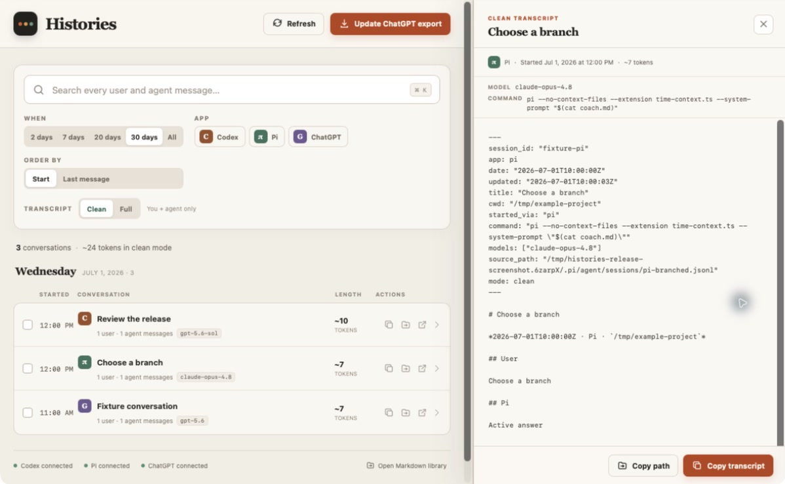

# Histories

<p align="center">
  
</p>

Histories is a local-first macOS desktop app and CLI for finding and reusing
conversations from Codex, Pi, and ChatGPT.

> **Public preview:** Histories is usable today, but the upstream conversation
> formats are not stable APIs. Parser compatibility is maintained on a
> best-effort basis with scrubbed regression fixtures.

It is built for a simple recurring task: find the conversations you had recently,
select the useful ones, and copy either their readable transcripts or their
Markdown paths into another agent session.



_Screenshot uses synthetic, scrubbed fixture data._

## What it does

- Shows recent conversations grouped by day, with app, time, models used,
  recoverable Pi launch commands, approximate token length, message counts, and
  working directory.
- Full-text searches user and assistant messages with SQLite FTS5.
- Highlights search terms in conversation previews and scrolls to the first
  match automatically.
- Keeps library and transcript scrolling inside their respective panes, with a
  draggable divider that remembers the preferred preview width.
- Keeps selections while search and filters change, then copies all selected
  conversations as one chronological Markdown bundle.
- Offers `clean` transcripts (user + agent messages) and on-demand `full`
  transcripts (including tools, tool results, reasoning summaries, and system
  records).
- Copies a transcript, copies its generated Markdown path, or reveals it in
  Finder.
- Refreshes changed source histories before CLI queries, when the app regains
  focus, and every 30 seconds while it remains visible.
- Reads source histories without modifying them. SQLite and Markdown are derived
  data stored under the Histories app-data directory.

## Install locally

Requirements: macOS, Xcode command-line tools, Rust, Node.js, and pnpm.

```bash
./scripts/install.sh
```

This installs:

- `~/Applications/Histories.app`
- `~/.local/bin/histories`

Open the app:

```bash
open ~/Applications/Histories.app
```

If `~/.local/bin` is not already on `PATH`, either add it or run the CLI using
its full path.

The local installer builds from source. Downloadable releases, when available,
are built for Apple Silicon and Intel, Developer ID signed, and notarized.

## CLI workflows

List the last two days:

```bash
histories list --since 2d
```

Search the last 20 days of user/agent messages:

```bash
histories search IFS --since 20d
```

Build the context file described in the original use case:

```bash
histories export \
  --query IFS \
  --since 20d \
  --mode clean \
  --output /tmp/ifs-sessions.md
```

Select particular results by their displayed numeric ID:

```bash
histories export \
  --id 385 \
  --id 524 \
  --id 523 \
  --mode clean \
  --output /tmp/selected-sessions.md
```

Print a transcript or its generated path:

```bash
histories show 385 --mode clean
histories show 385 --mode clean --path
```

Agent-friendly JSON is available from `list`, `search`, `refresh`, `sources`,
and `paths`:

```bash
histories search "deployment failure" --since 7d --json
```

Run a dedicated two-second polling watcher when desired:

```bash
histories watch --interval 2
```

Run `histories --help` or `histories <command> --help` for all filters.

## Sources and freshness

Default live sources:

- Codex: `~/.codex/sessions` and `~/.codex/archived_sessions`
- Pi: `~/.pi/agent/sessions`
- Pi launch commands: timestamped entries in `~/.zsh_history`

Pi histories are branch graphs. Histories follows the most recently active leaf
back to the root, so abandoned branches do not get mixed into the transcript.
Codex histories contain duplicate visible events; Histories keeps the canonical
user and assistant records while retaining tools for full mode.

Histories also reads model identifiers when those fields are present. Pi session
files do not preserve their launch arguments, so Histories correlates a session's
start time with a `pi` invocation in timestamped zsh history. It records the
command only when the timestamps are within five seconds; otherwise the field is
left blank. Exact Codex launch arguments are not available in Codex history.

The ChatGPT macOS app stores per-conversation `.data` files, but they are encrypted
and do not expose a stable readable transcript format. Histories therefore imports
the official ChatGPT `conversations.json` archive:

```bash
histories add-chatgpt-export /path/to/conversations.json
```

The desktop app exposes the same import through **Import ChatGPT**. Once registered,
the file is watched like the other sources; replacing it with a newer export updates
the catalog.

## Data locations

Inspect exact paths at any time:

```bash
histories paths
```

On this macOS setup the defaults are beneath:

```text
~/Library/Application Support/de.sebastian.Histories/
├── histories.sqlite3
├── config.json
└── exports/
    ├── clean/{codex,pi,chatgpt}/YYYY-MM/*.md
    └── full/{codex,pi,chatgpt}/YYYY-MM/*.full.md  # created on demand
```

Set `HISTORIES_DATA_DIR` or pass the global `--data-dir` option to isolate a
catalog. Set `HISTORIES_CHATGPT_EXPORT` to register one ChatGPT archive without a
config file.

The catalog and generated transcripts use private owner-only permissions on
macOS. Full transcripts can contain sensitive tool output, so they are generated
only when explicitly requested. See [PRIVACY.md](PRIVACY.md) for the complete
local-data model.

Token counts are intentionally approximate (`Unicode characters / 4`). They are
for quickly comparing conversation size, not billing.

## Development

```bash
pnpm install
cargo test --workspace
cargo clippy --workspace --all-targets -- -D warnings
pnpm test
pnpm build
pnpm tauri dev
```

Build the app bundle and CLI:

```bash
pnpm tauri build
cargo build --release -p histories-cli
```

The architecture has one Rust core (`crates/histories-core`) shared by the Tauri
desktop backend and `histories` CLI. Parsing, incremental refresh, Markdown
generation, SQLite, and FTS behavior therefore stay identical across both surfaces.

## Project policies

- [Privacy and local data](PRIVACY.md)
- [Security reporting](SECURITY.md)
- [Contributing](CONTRIBUTING.md)
- [Release process](docs/RELEASING.md)
- [Changelog](CHANGELOG.md)

Histories is available under the [MIT License](LICENSE).
